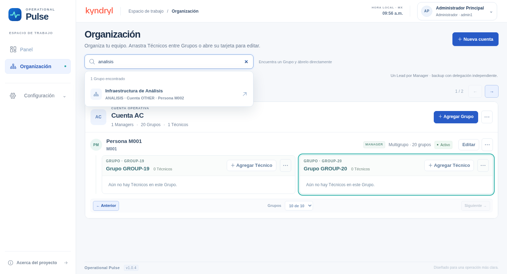
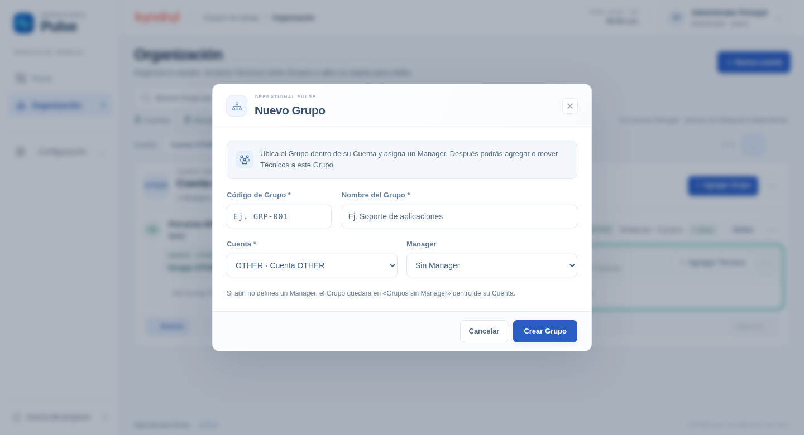
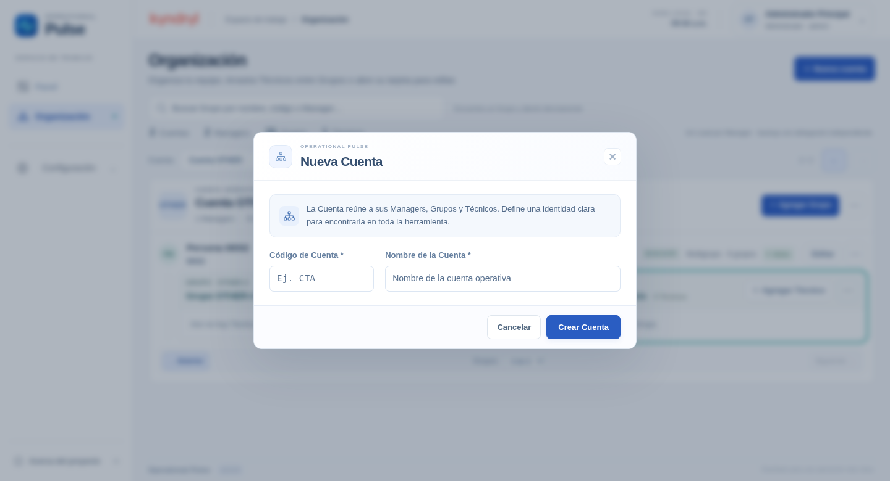

# Organización · v1.0.4

Capturas reales de Chromium a zoom nativo, con datos aislados de prueba. La base de la aplicación no recibe estos registros.

## Buscar y abrir un Grupo

Escribe un nombre o código de Grupo, Cuenta o Manager. Elegir un resultado abre directamente su posición dentro de Cuenta → Manager → Grupo, aunque esté en otra página. El Grupo aparece resaltado. Se mantienen el arrastre de Técnicos y la paginación.

## Nuevo Grupo

Modal de 680 px como máximo, con código/nombre, Cuenta/Manager e instrucciones breves. Conserva la opción de crear un Grupo pendiente de Manager.

## Nueva Cuenta

Modal de 620 px como máximo, proporcionado a sus dos campos y con acción explícita Crear Cuenta.

Verificación: 28 pruebas API, prueba funcional completa, 57 combinaciones de pantalla y prueba de búsqueda con 26 Grupos. Mac/Safari pendientes.
