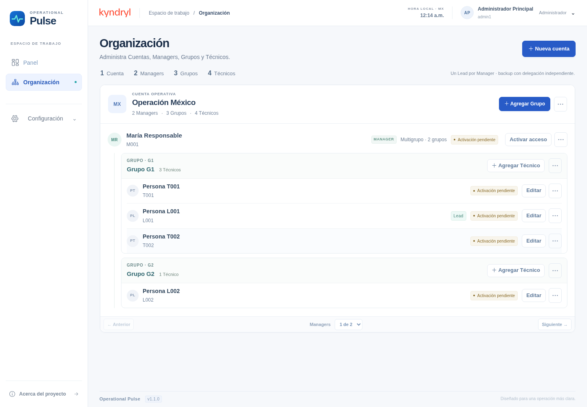
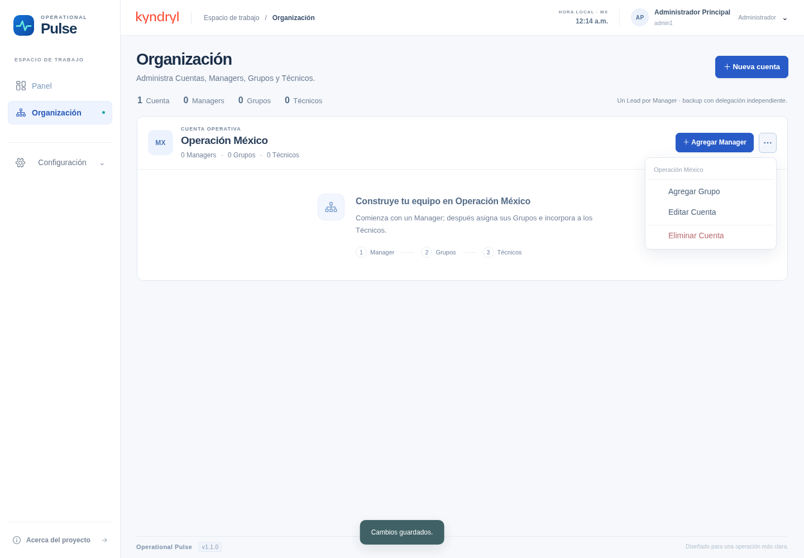

# Operational Pulse · Enterprise luminosa · v1.1.0

Nueva interfaz seleccionada por Samuel: navegación clara, azul profundo y acentos turquesa. Capturas reales de Chromium al 100% de zoom, con datos temporales exclusivos de las pruebas. La instalación nueva no contiene estos equipos ni usuarios.

## Organización con equipo

Sidebar blanco, marca de producto independiente, Kyndryl en la cabecera y jerarquía organizativa sobre superficies claras.

## Cuenta nueva y menú de acciones

La primera acción propone incorporar al Manager. Los menús usan opciones con iconos, sin botones apilados; conservan las validaciones de creación, edición y eliminación.

Comprobación funcional: 23 pruebas de backend, recorrido de navegador y 54 combinaciones de rol/ruta/viewport. No se probó en una Mac física ni Safari.
