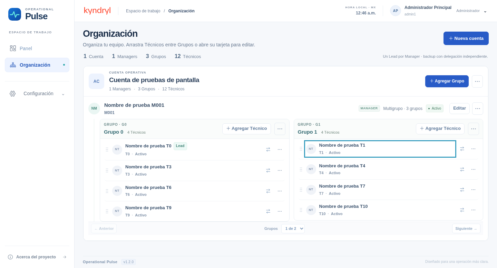
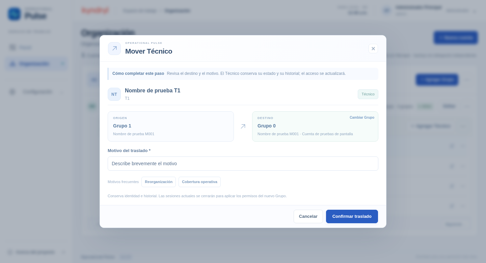

# Operational Pulse · Organización interactiva · v1.2.0

Capturas reales de Chromium al 100% de zoom, con datos temporales de las pruebas.

## Tablero de Grupos

Los Grupos se presentan lado a lado. Usa el asa de puntos para arrastrar Técnicos, la flecha Mover para hacerlo con teclado y los nombres para abrir su edición en un modal.

## Revisión después de soltar

El destino queda seleccionado. Revisa origen y destino, elige un motivo y confirma. Cancelar conserva la asignación original. Cambiar Grupo permite escoger otro destino.

Sólo Admin puede reorganizar personas. Se mantienen los controles de Timer activo, Manager activo y Lead único por Manager. El servidor comprueba el origen e incorpora los datos vigentes del perfil.

Validación: 25 pruebas API, 54 combinaciones de rol/ruta/viewport y arrastrar/soltar reales, incluyendo cancelación, confirmación, alternativa de teclado y bloqueo de Timer. Chromium/Linux; Mac física y Safari pendientes. La instalación nueva contiene únicamente admin1 y admin2.
